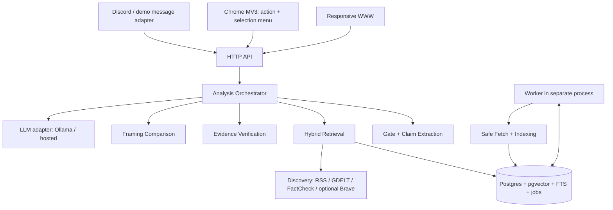
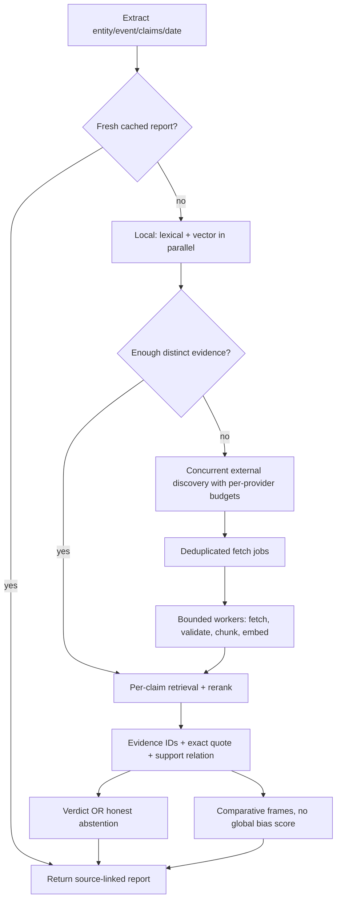
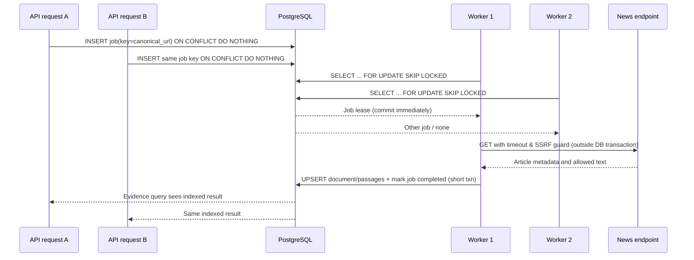
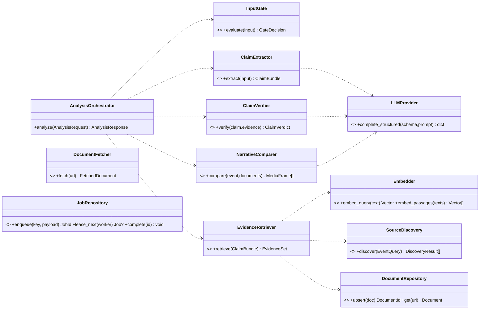

# Architecture (C4-lite / UML)

## Context and adapters

## Retrieval's precise hot path

## Worker with durable ownership

## Main UML ports/interfaces

**Deployment:** one repo, one backend codebase, API and worker processes. NO microservices, no queue server, no content-script that continuously monitors browsing.
